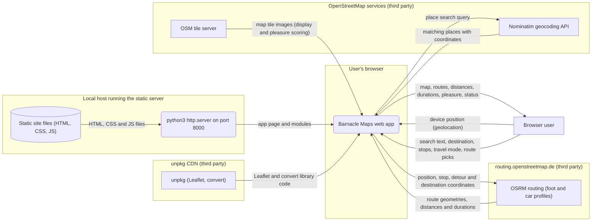

# Data flow

How data moves through this repo: who and what it exchanges data with, where it keeps it, and which trust zone each part runs in. Generated by the software factory from [`model.json`](model.json) in every pull request: do not edit this file, it is rewritten.

Boxes are external actors, rounded boxes processes, cylinders data stores; a frame is a trust zone.

## Parts

| Part | Kind | Zone | Sources |
|---|---|---|---|
| Nominatim geocoding API | actor | OpenStreetMap services (third party) |  |
| OSM tile server | actor | OpenStreetMap services (third party) |  |
| OSRM routing (foot and car profiles) | actor | routing.openstreetmap.de (third party) |  |
| Static site files (HTML, CSS, JS) | store | Local host running the static server | `index.html`, `src`, `styles.css` |
| python3 http.server on port 8000 | process | Local host running the static server | `package.json` |
| unpkg (Leaflet, convert) | actor | unpkg CDN (third party) |  |
| Browser user | actor |  |  |
| Barnacle Maps web app | process | User's browser | `index.html`, `src/app.js`, `src/geo.js` |

## Flows

| From | To | Data | Sources |
|---|---|---|---|
| Nominatim geocoding API | Barnacle Maps web app | matching places with coordinates | `src/app.js`, `src/geo.js` |
| OSM tile server | Barnacle Maps web app | map tile images (display and pleasure scoring) | `src/app.js` |
| OSRM routing (foot and car profiles) | Barnacle Maps web app | route geometries, distances and durations | `src/app.js`, `src/geo.js` |
| Static site files (HTML, CSS, JS) | python3 http.server on port 8000 | HTML, CSS and JS files | `index.html`, `package.json` |
| python3 http.server on port 8000 | Barnacle Maps web app | app page and modules | `index.html`, `package.json` |
| unpkg (Leaflet, convert) | Barnacle Maps web app | Leaflet and convert library code | `index.html`, `src/geo.js` |
| Browser user | Barnacle Maps web app | device position (geolocation) | `src/app.js` |
| Browser user | Barnacle Maps web app | search text, destination, stops, travel mode, route picks | `src/app.js` |
| Barnacle Maps web app | Nominatim geocoding API | place search query | `src/app.js`, `src/geo.js` |
| Barnacle Maps web app | OSRM routing (foot and car profiles) | position, stop, detour and destination coordinates | `src/app.js`, `src/geo.js` |
| Barnacle Maps web app | Browser user | map, routes, distances, durations, pleasure, status | `src/app.js`, `src/geo.js` |
