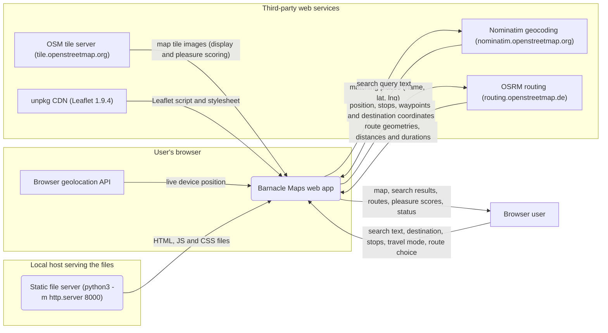

# Data flow

How data moves through this repo: who and what it exchanges data with, where it keeps it, and which trust zone each part runs in. Generated by the software factory from [`model.json`](model.json) in every pull request: do not edit this file, it is rewritten.

Boxes are external actors, rounded boxes processes, cylinders data stores; a frame is a trust zone.

## Parts

| Part | Kind | Zone | Sources |
|---|---|---|---|
| Browser geolocation API | actor | User's browser |  |
| Nominatim geocoding (nominatim.openstreetmap.org) | actor | Third-party web services |  |
| OSM tile server (tile.openstreetmap.org) | actor | Third-party web services |  |
| OSRM routing (routing.openstreetmap.de) | actor | Third-party web services |  |
| Static file server (python3 -m http.server 8000) | process | Local host serving the files | `package.json` |
| unpkg CDN (Leaflet 1.9.4) | actor | Third-party web services |  |
| Browser user | actor |  |  |
| Barnacle Maps web app | process | User's browser | `index.html`, `src/app.js`, `src/geo.js` |

## Flows

| From | To | Data | Sources |
|---|---|---|---|
| Browser geolocation API | Barnacle Maps web app | live device position | `src/app.js` |
| Nominatim geocoding (nominatim.openstreetmap.org) | Barnacle Maps web app | matching places (name, lat, lng) | `src/app.js`, `src/geo.js` |
| OSM tile server (tile.openstreetmap.org) | Barnacle Maps web app | map tile images (display and pleasure scoring) | `src/app.js` |
| OSRM routing (routing.openstreetmap.de) | Barnacle Maps web app | route geometries, distances and durations | `src/app.js`, `src/geo.js` |
| Static file server (python3 -m http.server 8000) | Barnacle Maps web app | HTML, JS and CSS files | `index.html`, `package.json` |
| unpkg CDN (Leaflet 1.9.4) | Barnacle Maps web app | Leaflet script and stylesheet | `index.html` |
| Browser user | Barnacle Maps web app | search text, destination, stops, travel mode, route choice | `index.html`, `src/app.js` |
| Barnacle Maps web app | Nominatim geocoding (nominatim.openstreetmap.org) | search query text | `src/app.js`, `src/geo.js` |
| Barnacle Maps web app | OSRM routing (routing.openstreetmap.de) | position, stops, waypoints and destination coordinates | `src/app.js`, `src/geo.js` |
| Barnacle Maps web app | Browser user | map, search results, routes, pleasure scores, status | `src/app.js` |
