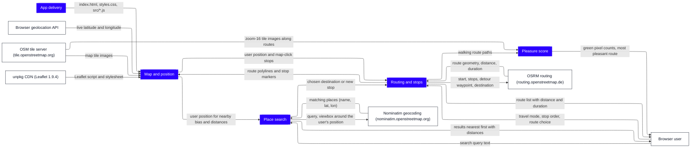
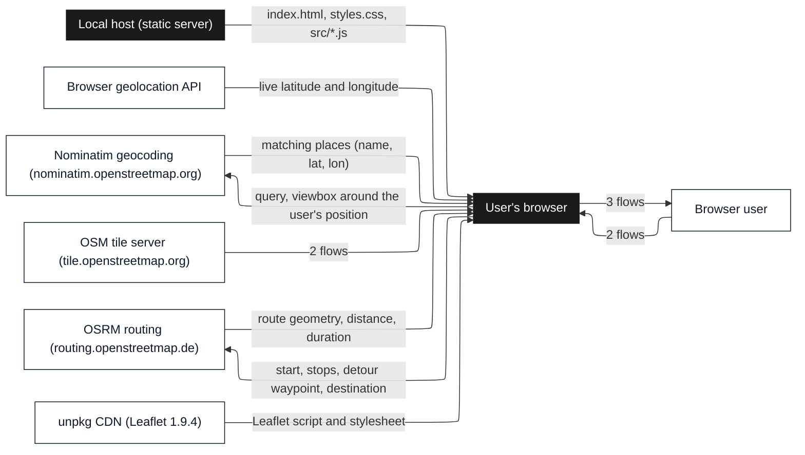
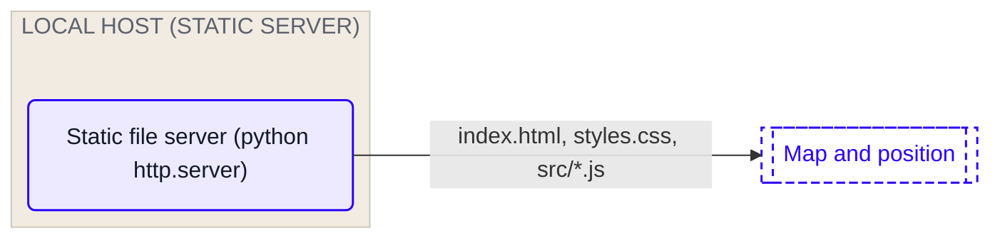
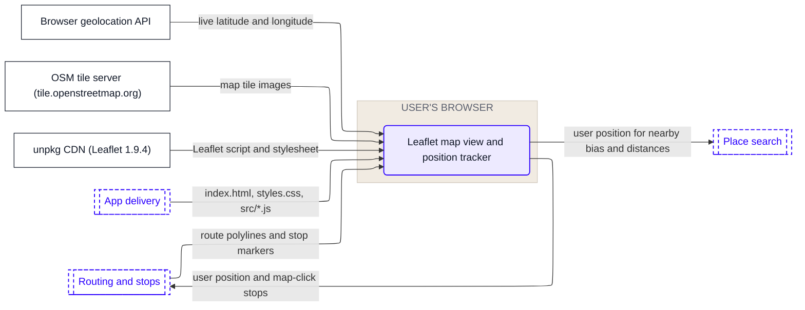
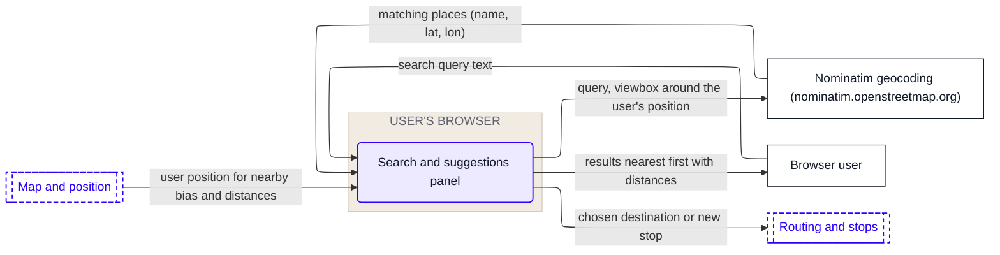
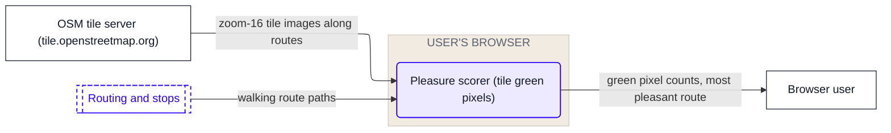
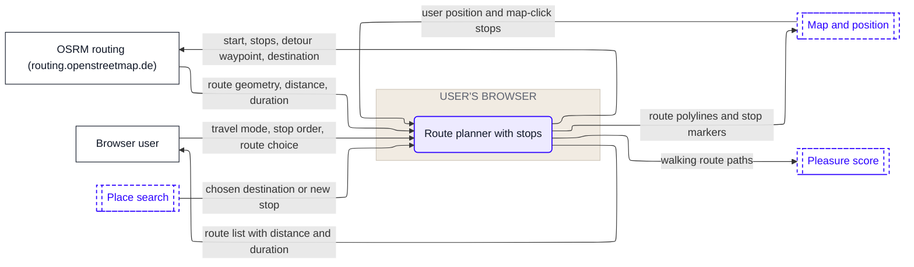

# Data flow

How data moves through this repo: who and what it exchanges data with, where it keeps it, and which trust zone each part runs in. Generated by the software factory from [`model.json`](model.json) in every pull request: do not edit this file, it is rewritten. The dashboard's Data flow page shows the same views.

White boxes are outside actors, blue rounded boxes processes, cylinders data stores, a frame a trust zone. A dark box is a whole trust zone, a blue box a whole subsystem (dashed: a neighbouring one).

## Subsystems

Processes and stores grouped by the job they do, with the outside actors they talk to.

| Subsystem | What it does | Parts |
|---|---|---|
| App delivery | Serves the page, styles and app code to the browser Leaflet comes from a CDN. | Static file server (python http.server) |
| Map and position | Draws the OpenStreetMap map, tracks the user's live position and takes map clicks for stops. | Leaflet map view and position tracker |
| Place search | Geocodes the typed query with Nominatim, near the user when known, and lists results nearest first. | Search and suggestions panel |
| Pleasure score | Counts green pixels on OSM tiles along each walking route to mark the most pleasant one. | Pleasure scorer (tile green pixels) |
| Routing and stops | Asks OSRM for walking or car routes through the user's stops and shows them on the map and panel. | Route planner with stops |

## Trust boundaries

Each zone that runs the repo's code is one dark box; outside services stay separate. An arrow is every flow that crosses from one box to another.

## Each subsystem

### App delivery

Serves the page, styles and app code to the browser Leaflet comes from a CDN.

### Map and position

Draws the OpenStreetMap map, tracks the user's live position and takes map clicks for stops.

### Place search

Geocodes the typed query with Nominatim, near the user when known, and lists results nearest first.

### Pleasure score

Counts green pixels on OSM tiles along each walking route to mark the most pleasant one.

### Routing and stops

Asks OSRM for walking or car routes through the user's stops and shows them on the map and panel.

## Parts

| Part | Kind | Subsystem | Zone | Sources |
|---|---|---|---|---|
| Browser geolocation API | actor |  |  |  |
| Leaflet map view and position tracker | process | Map and position | User's browser | `src/app.js` |
| Nominatim geocoding (nominatim.openstreetmap.org) | actor |  |  |  |
| OSM tile server (tile.openstreetmap.org) | actor |  |  |  |
| OSRM routing (routing.openstreetmap.de) | actor |  |  |  |
| Pleasure scorer (tile green pixels) | process | Pleasure score | User's browser | `src/app.js`, `src/geo.js` |
| Route planner with stops | process | Routing and stops | User's browser | `src/app.js`, `src/geo.js` |
| Search and suggestions panel | process | Place search | User's browser | `src/app.js`, `src/geo.js` |
| Static file server (python http.server) | process | App delivery | Local host (static server) | `index.html`, `package.json` |
| unpkg CDN (Leaflet 1.9.4) | actor |  |  |  |
| Browser user | actor |  |  |  |

## Flows

| From | To | Data | Sources |
|---|---|---|---|
| Browser geolocation API | Leaflet map view and position tracker | live latitude and longitude | `src/app.js` |
| Leaflet map view and position tracker | Route planner with stops | user position and map-click stops | `src/app.js` |
| Leaflet map view and position tracker | Search and suggestions panel | user position for nearby bias and distances | `src/app.js` |
| Nominatim geocoding (nominatim.openstreetmap.org) | Search and suggestions panel | matching places (name, lat, lon) | `src/app.js`, `src/geo.js` |
| OSM tile server (tile.openstreetmap.org) | Leaflet map view and position tracker | map tile images | `src/app.js` |
| OSM tile server (tile.openstreetmap.org) | Pleasure scorer (tile green pixels) | zoom-16 tile images along routes | `src/app.js` |
| OSRM routing (routing.openstreetmap.de) | Route planner with stops | route geometry, distance, duration | `src/app.js`, `src/geo.js` |
| Pleasure scorer (tile green pixels) | Browser user | green pixel counts, most pleasant route | `src/app.js`, `src/geo.js` |
| Route planner with stops | Leaflet map view and position tracker | route polylines and stop markers | `src/app.js` |
| Route planner with stops | OSRM routing (routing.openstreetmap.de) | start, stops, detour waypoint, destination | `src/app.js`, `src/geo.js` |
| Route planner with stops | Pleasure scorer (tile green pixels) | walking route paths | `src/app.js` |
| Route planner with stops | Browser user | route list with distance and duration | `src/app.js` |
| Search and suggestions panel | Nominatim geocoding (nominatim.openstreetmap.org) | query, viewbox around the user's position | `src/app.js`, `src/geo.js` |
| Search and suggestions panel | Route planner with stops | chosen destination or new stop | `src/app.js` |
| Search and suggestions panel | Browser user | results nearest first with distances | `src/app.js` |
| Static file server (python http.server) | Leaflet map view and position tracker | index.html, styles.css, src/*.js | `index.html`, `package.json` |
| unpkg CDN (Leaflet 1.9.4) | Leaflet map view and position tracker | Leaflet script and stylesheet | `index.html` |
| Browser user | Route planner with stops | travel mode, stop order, route choice | `index.html`, `src/app.js` |
| Browser user | Search and suggestions panel | search query text | `src/app.js` |
