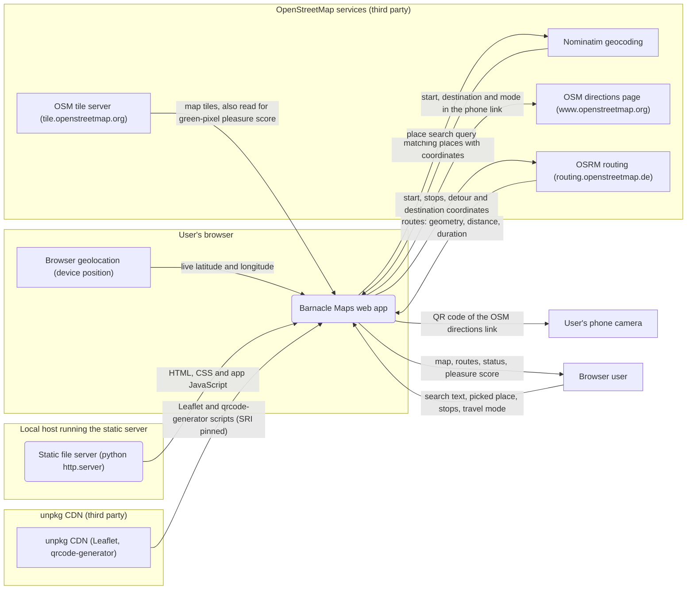

# Data flow

How data moves through this repo: who and what it exchanges data with, where it keeps it, and which trust zone each part runs in. Generated by the software factory from [`model.json`](model.json) in every pull request: do not edit this file, it is rewritten.

Boxes are external actors, rounded boxes processes, cylinders data stores; a frame is a trust zone.

## Parts

| Part | Kind | Zone | Sources |
|---|---|---|---|
| Browser geolocation (device position) | actor | User's browser |  |
| Nominatim geocoding | actor | OpenStreetMap services (third party) |  |
| OSM directions page (www.openstreetmap.org) | actor | OpenStreetMap services (third party) |  |
| OSM tile server (tile.openstreetmap.org) | actor | OpenStreetMap services (third party) |  |
| OSRM routing (routing.openstreetmap.de) | actor | OpenStreetMap services (third party) |  |
| User's phone camera | actor |  |  |
| Static file server (python http.server) | process | Local host running the static server | `index.html`, `package.json` |
| unpkg CDN (Leaflet, qrcode-generator) | actor | unpkg CDN (third party) |  |
| Browser user | actor |  |  |
| Barnacle Maps web app | process | User's browser | `src/app.js`, `src/geo.js`, `src/qr.js` |

## Flows

| From | To | Data | Sources |
|---|---|---|---|
| Browser geolocation (device position) | Barnacle Maps web app | live latitude and longitude | `src/app.js` |
| Nominatim geocoding | Barnacle Maps web app | matching places with coordinates | `src/app.js`, `src/geo.js` |
| OSM tile server (tile.openstreetmap.org) | Barnacle Maps web app | map tiles, also read for green-pixel pleasure score | `src/app.js`, `src/geo.js` |
| OSRM routing (routing.openstreetmap.de) | Barnacle Maps web app | routes: geometry, distance, duration | `src/app.js`, `src/geo.js` |
| Static file server (python http.server) | Barnacle Maps web app | HTML, CSS and app JavaScript | `index.html`, `package.json` |
| unpkg CDN (Leaflet, qrcode-generator) | Barnacle Maps web app | Leaflet and qrcode-generator scripts (SRI pinned) | `index.html`, `pins.json` |
| Browser user | Barnacle Maps web app | search text, picked place, stops, travel mode | `src/app.js` |
| Barnacle Maps web app | Nominatim geocoding | place search query | `src/app.js`, `src/geo.js` |
| Barnacle Maps web app | OSM directions page (www.openstreetmap.org) | start, destination and mode in the phone link | `src/app.js`, `src/geo.js` |
| Barnacle Maps web app | OSRM routing (routing.openstreetmap.de) | start, stops, detour and destination coordinates | `src/app.js`, `src/geo.js` |
| Barnacle Maps web app | User's phone camera | QR code of the OSM directions link | `src/app.js`, `src/qr.js` |
| Barnacle Maps web app | Browser user | map, routes, status, pleasure score | `index.html`, `src/app.js` |
