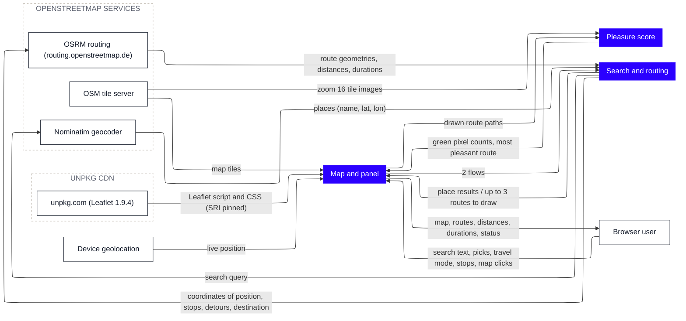
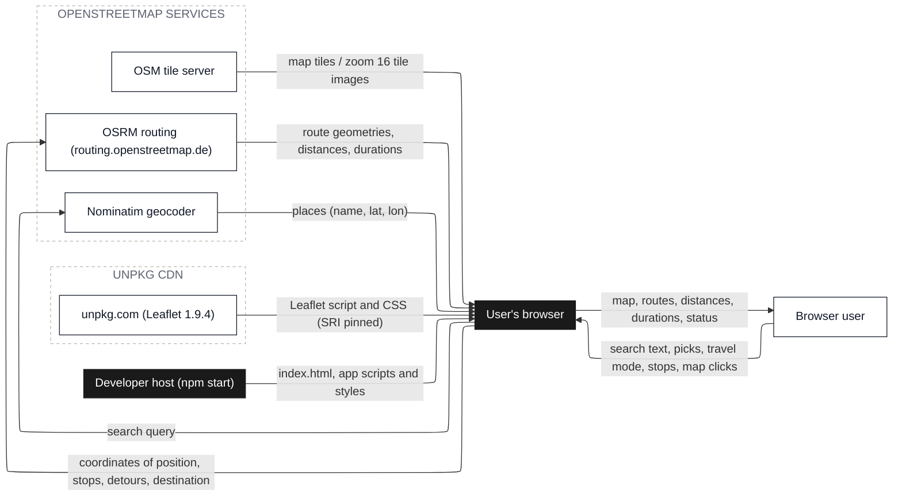
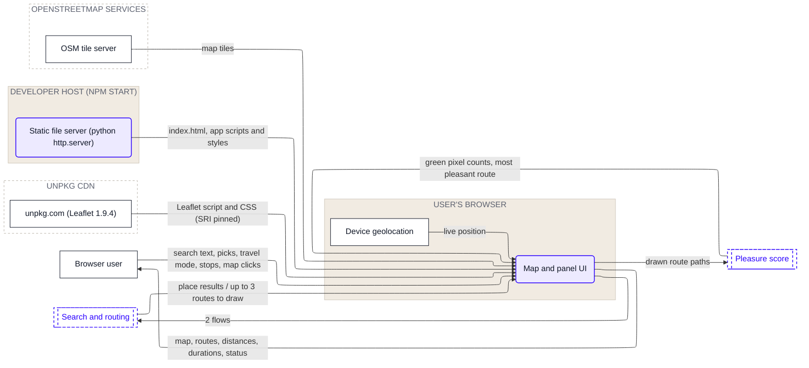
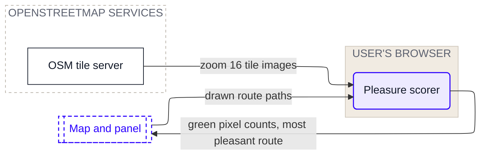
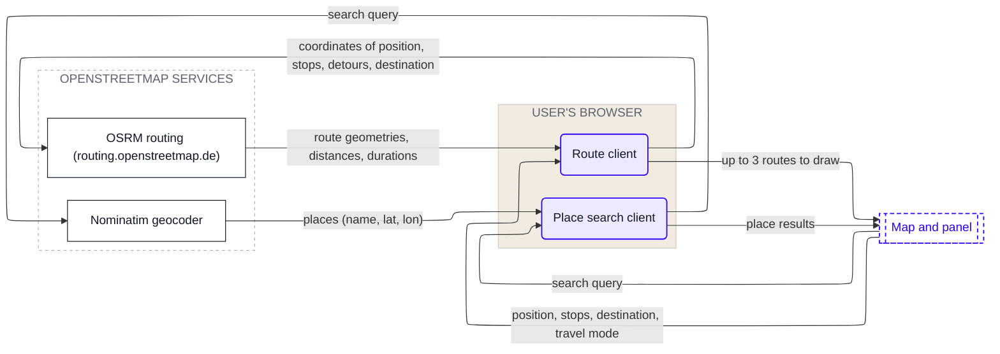

# Data flow

How data moves through this repo: who and what it exchanges data with, where it keeps it, and which trust zone each part runs in. Generated by the software factory from [`model.json`](model.json) in every pull request: do not edit this file, it is rewritten. The dashboard's Data flow page shows the same views.

White boxes are outside actors, blue rounded boxes processes, cylinders data stores, a frame a trust zone. A dark box is a whole trust zone, a blue box a whole subsystem (dashed: a neighbouring one).

## Subsystems

Processes and stores grouped by the job they do, with the outside actors they talk to.

| Subsystem | What it does | Parts |
|---|---|---|
| Map and panel | Serves the page and runs the Leaflet map and side panel the user works with. | Map and panel UI, Static file server (python http.server) |
| Pleasure score | Counts green pixels on OSM tiles along each walking or cycling route to mark the most pleasant one. | Pleasure scorer |
| Search and routing | Turns a typed place into coordinates and asks OSRM for walk, bike or car routes through the stops. | Route client, Place search client |

## Trust boundaries

Each zone that runs the repo's code is one dark box; outside services stay separate. An arrow is every flow that crosses from one box to another.

## Each subsystem

### Map and panel

Serves the page and runs the Leaflet map and side panel the user works with.

### Pleasure score

Counts green pixels on OSM tiles along each walking or cycling route to mark the most pleasant one.

### Search and routing

Turns a typed place into coordinates and asks OSRM for walk, bike or car routes through the stops.

## Parts

| Part | Kind | Subsystem | Zone | Sources |
|---|---|---|---|---|
| Device geolocation | actor |  | User's browser |  |
| Map and panel UI | process | Map and panel | User's browser | `index.html`, `src/app.js` |
| Nominatim geocoder | actor |  | OpenStreetMap services |  |
| OSM tile server | actor |  | OpenStreetMap services |  |
| OSRM routing (routing.openstreetmap.de) | actor |  | OpenStreetMap services |  |
| Pleasure scorer | process | Pleasure score | User's browser | `src/app.js`, `src/geo.js` |
| Route client | process | Search and routing | User's browser | `src/app.js`, `src/geo.js` |
| Place search client | process | Search and routing | User's browser | `src/app.js`, `src/geo.js` |
| Static file server (python http.server) | process | Map and panel | Developer host (npm start) | `package.json` |
| unpkg.com (Leaflet 1.9.4) | actor |  | unpkg CDN |  |
| Browser user | actor |  |  |  |

## Flows

| From | To | Data | Sources |
|---|---|---|---|
| Device geolocation | Map and panel UI | live position | `src/app.js` |
| Map and panel UI | Pleasure scorer | drawn route paths | `src/app.js` |
| Map and panel UI | Route client | position, stops, destination, travel mode | `src/app.js` |
| Map and panel UI | Place search client | search query | `src/app.js` |
| Map and panel UI | Browser user | map, routes, distances, durations, status | `src/app.js` |
| Nominatim geocoder | Place search client | places (name, lat, lon) | `src/app.js`, `src/geo.js` |
| OSM tile server | Map and panel UI | map tiles | `src/app.js` |
| OSM tile server | Pleasure scorer | zoom 16 tile images | `src/app.js` |
| OSRM routing (routing.openstreetmap.de) | Route client | route geometries, distances, durations | `src/app.js`, `src/geo.js` |
| Pleasure scorer | Map and panel UI | green pixel counts, most pleasant route | `src/app.js`, `src/geo.js` |
| Route client | Map and panel UI | up to 3 routes to draw | `src/app.js` |
| Route client | OSRM routing (routing.openstreetmap.de) | coordinates of position, stops, detours, destination | `src/app.js`, `src/geo.js` |
| Place search client | Map and panel UI | place results | `src/app.js` |
| Place search client | Nominatim geocoder | search query | `src/app.js`, `src/geo.js` |
| Static file server (python http.server) | Map and panel UI | index.html, app scripts and styles | `index.html`, `package.json` |
| unpkg.com (Leaflet 1.9.4) | Map and panel UI | Leaflet script and CSS (SRI pinned) | `index.html`, `pins.json` |
| Browser user | Map and panel UI | search text, picks, travel mode, stops, map clicks | `index.html`, `src/app.js` |
