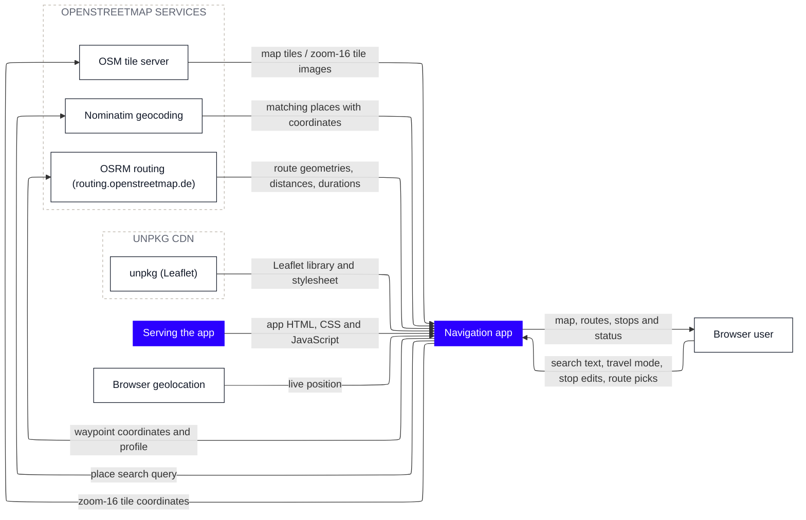
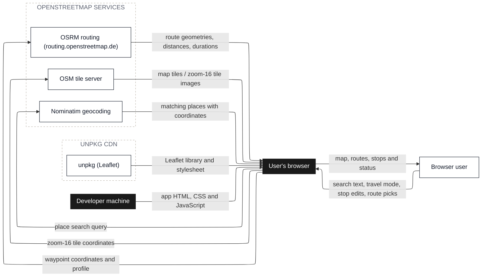
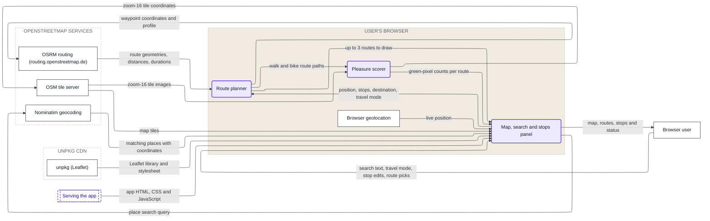
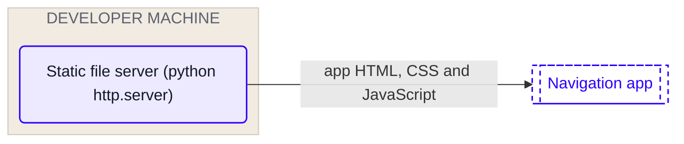

# Data flow

How data moves through this repo: who and what it exchanges data with, where it keeps it, and which trust zone each part runs in. Generated by the software factory from [`model.json`](model.json) in every pull request: do not edit this file, it is rewritten. The dashboard's Data flow page shows the same views.

White boxes are outside actors, blue rounded boxes processes, cylinders data stores, a frame a trust zone. A dark box is a whole trust zone, a blue box a whole subsystem (dashed: a neighbouring one).

## Subsystems

Processes and stores grouped by the job they do, with the outside actors they talk to.

| Subsystem | What it does | Parts |
|---|---|---|
| Navigation app | Runs in the browser: searches places, plans walk, car and bike routes with stops, and scores how green they are. | Pleasure scorer, Route planner, Map, search and stops panel |
| Serving the app | Serves the static HTML, CSS and JavaScript of the app to the browser on localhost. | Static file server (python http.server) |

## Trust boundaries

Each zone that runs the repo's code is one dark box; outside services stay separate. An arrow is every flow that crosses from one box to another.

## Each subsystem

### Navigation app

Runs in the browser: searches places, plans walk, car and bike routes with stops, and scores how green they are.

### Serving the app

Serves the static HTML, CSS and JavaScript of the app to the browser on localhost.

## Parts

| Part | Kind | Subsystem | Zone | Sources |
|---|---|---|---|---|
| Browser geolocation | actor |  | User's browser |  |
| Nominatim geocoding | actor |  | OpenStreetMap services |  |
| OSM tile server | actor |  | OpenStreetMap services |  |
| OSRM routing (routing.openstreetmap.de) | actor |  | OpenStreetMap services |  |
| Pleasure scorer | process | Navigation app | User's browser | `src/app.js`, `src/geo.js` |
| Route planner | process | Navigation app | User's browser | `src/app.js`, `src/geo.js` |
| Static file server (python http.server) | process | Serving the app | Developer machine | `package.json` |
| Map, search and stops panel | process | Navigation app | User's browser | `index.html`, `src/app.js` |
| unpkg (Leaflet) | actor |  | unpkg CDN |  |
| Browser user | actor |  |  |  |

## Flows

| From | To | Data | Sources |
|---|---|---|---|
| Browser geolocation | Map, search and stops panel | live position | `src/app.js` |
| Nominatim geocoding | Map, search and stops panel | matching places with coordinates | `src/app.js`, `src/geo.js` |
| OSM tile server | Pleasure scorer | zoom-16 tile images | `src/app.js` |
| OSM tile server | Map, search and stops panel | map tiles | `src/app.js` |
| OSRM routing (routing.openstreetmap.de) | Route planner | route geometries, distances, durations | `src/app.js`, `src/geo.js` |
| Pleasure scorer | OSM tile server | zoom-16 tile coordinates | `src/app.js` |
| Pleasure scorer | Map, search and stops panel | green-pixel counts per route | `src/app.js`, `src/geo.js` |
| Route planner | OSRM routing (routing.openstreetmap.de) | waypoint coordinates and profile | `src/app.js`, `src/geo.js` |
| Route planner | Pleasure scorer | walk and bike route paths | `src/app.js` |
| Route planner | Map, search and stops panel | up to 3 routes to draw | `src/app.js` |
| Static file server (python http.server) | Map, search and stops panel | app HTML, CSS and JavaScript | `index.html`, `package.json` |
| Map, search and stops panel | Nominatim geocoding | place search query | `src/app.js`, `src/geo.js` |
| Map, search and stops panel | Route planner | position, stops, destination, travel mode | `src/app.js` |
| Map, search and stops panel | Browser user | map, routes, stops and status | `src/app.js` |
| unpkg (Leaflet) | Map, search and stops panel | Leaflet library and stylesheet | `index.html` |
| Browser user | Map, search and stops panel | search text, travel mode, stop edits, route picks | `index.html`, `src/app.js` |
