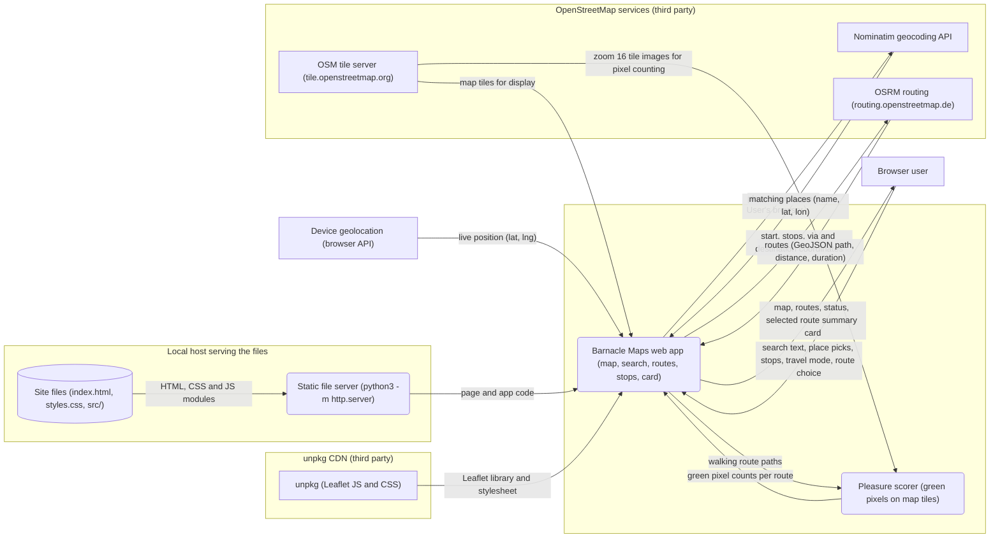

# Data flow

How data moves through this repo: who and what it exchanges data with, where it keeps it, and which trust zone each part runs in. Generated by the software factory from [`model.json`](model.json) in every pull request: do not edit this file, it is rewritten.

Boxes are external actors, rounded boxes processes, cylinders data stores; a frame is a trust zone.

## Parts

| Part | Kind | Zone | Sources |
|---|---|---|---|
| Barnacle Maps web app (map, search, routes, stops, card) | process | User's browser | `index.html`, `src/app.js`, `src/geo.js` |
| Device geolocation (browser API) | actor |  |  |
| Nominatim geocoding API | actor | OpenStreetMap services (third party) |  |
| OSRM routing (routing.openstreetmap.de) | actor | OpenStreetMap services (third party) |  |
| Pleasure scorer (green pixels on map tiles) | process | User's browser | `src/app.js`, `src/geo.js` |
| Site files (index.html, styles.css, src/) | store | Local host serving the files | `index.html`, `src`, `styles.css` |
| Static file server (python3 -m http.server) | process | Local host serving the files | `package.json` |
| OSM tile server (tile.openstreetmap.org) | actor | OpenStreetMap services (third party) |  |
| unpkg (Leaflet JS and CSS) | actor | unpkg CDN (third party) |  |
| Browser user | actor |  |  |

## Flows

| From | To | Data | Sources |
|---|---|---|---|
| Barnacle Maps web app (map, search, routes, stops, card) | Nominatim geocoding API | place search query | `src/app.js`, `src/geo.js` |
| Barnacle Maps web app (map, search, routes, stops, card) | OSRM routing (routing.openstreetmap.de) | start, stops, via and destination coordinates | `src/app.js`, `src/geo.js` |
| Barnacle Maps web app (map, search, routes, stops, card) | Pleasure scorer (green pixels on map tiles) | walking route paths | `src/app.js` |
| Barnacle Maps web app (map, search, routes, stops, card) | Browser user | map, routes, status, selected route summary card | `index.html`, `src/app.js` |
| Device geolocation (browser API) | Barnacle Maps web app (map, search, routes, stops, card) | live position (lat, lng) | `src/app.js` |
| Nominatim geocoding API | Barnacle Maps web app (map, search, routes, stops, card) | matching places (name, lat, lon) | `src/app.js`, `src/geo.js` |
| OSRM routing (routing.openstreetmap.de) | Barnacle Maps web app (map, search, routes, stops, card) | routes (GeoJSON path, distance, duration) | `src/app.js`, `src/geo.js` |
| Pleasure scorer (green pixels on map tiles) | Barnacle Maps web app (map, search, routes, stops, card) | green pixel counts per route | `src/app.js`, `src/geo.js` |
| Site files (index.html, styles.css, src/) | Static file server (python3 -m http.server) | HTML, CSS and JS modules | `package.json` |
| Static file server (python3 -m http.server) | Barnacle Maps web app (map, search, routes, stops, card) | page and app code | `index.html`, `package.json` |
| OSM tile server (tile.openstreetmap.org) | Barnacle Maps web app (map, search, routes, stops, card) | map tiles for display | `src/app.js` |
| OSM tile server (tile.openstreetmap.org) | Pleasure scorer (green pixels on map tiles) | zoom 16 tile images for pixel counting | `src/app.js` |
| unpkg (Leaflet JS and CSS) | Barnacle Maps web app (map, search, routes, stops, card) | Leaflet library and stylesheet | `index.html` |
| Browser user | Barnacle Maps web app (map, search, routes, stops, card) | search text, place picks, stops, travel mode, route choice | `index.html`, `src/app.js` |
