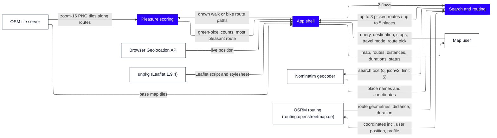
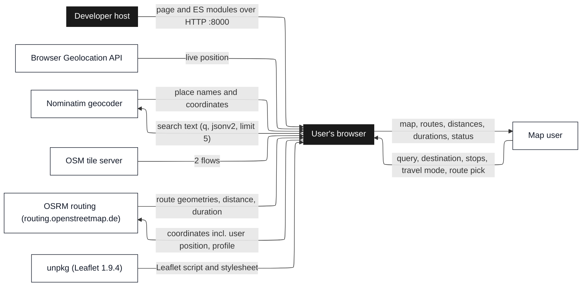
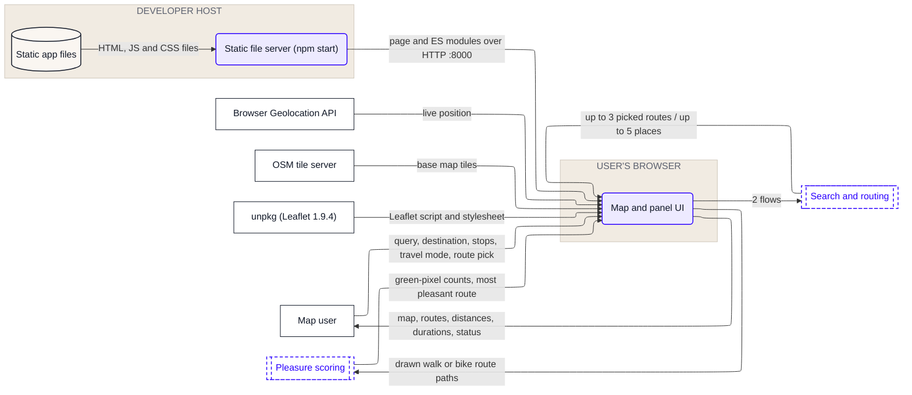
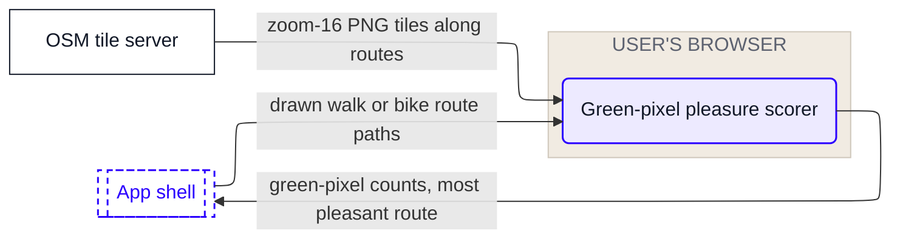
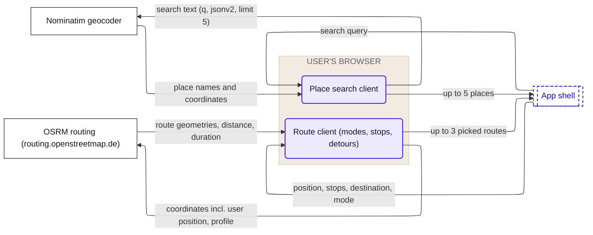

# Data flow

How data moves through this repo: who and what it exchanges data with, where it keeps it, and which trust zone each part runs in. Generated by the software factory from [`model.json`](model.json) in every pull request: do not edit this file, it is rewritten. The dashboard's Data flow page shows the same views.

White boxes are outside actors, blue rounded boxes processes, cylinders data stores, a frame a trust zone. A dark box is a whole trust zone, a blue box a whole subsystem (dashed: a neighbouring one).

## Subsystems

Processes and stores grouped by the job they do, with the outside actors they talk to.

| Subsystem | What it does | Parts |
|---|---|---|
| App shell | Serves the static page and runs the map, panel, position, stops and travel-mode state in the browser. | Static file server (npm start), Map and panel UI, Static app files |
| Pleasure scoring | Loads OSM tiles along walking and bike routes and counts green pixels to mark the most pleasant route. | Green-pixel pleasure scorer |
| Search and routing | Turns a typed query into places with Nominatim and asks OSRM for walk, bike or car routes through the stops. | Route client (modes, stops, detours), Place search client |

## Trust boundaries

Each zone that runs the repo's code is one dark box; outside services stay separate. An arrow is every flow that crosses from one box to another.

## Each subsystem

### App shell

Serves the static page and runs the map, panel, position, stops and travel-mode state in the browser.

### Pleasure scoring

Loads OSM tiles along walking and bike routes and counts green pixels to mark the most pleasant route.

### Search and routing

Turns a typed query into places with Nominatim and asks OSRM for walk, bike or car routes through the stops.

## Parts

| Part | Kind | Subsystem | Zone | Sources |
|---|---|---|---|---|
| Static file server (npm start) | process | App shell | Developer host | `package.json` |
| Browser Geolocation API | actor |  |  |  |
| Map and panel UI | process | App shell | User's browser | `index.html`, `src/app.js` |
| Nominatim geocoder | actor |  |  |  |
| OSM tile server | actor |  |  |  |
| OSRM routing (routing.openstreetmap.de) | actor |  |  |  |
| Green-pixel pleasure scorer | process | Pleasure scoring | User's browser | `src/app.js`, `src/geo.js` |
| Route client (modes, stops, detours) | process | Search and routing | User's browser | `src/app.js`, `src/geo.js` |
| Place search client | process | Search and routing | User's browser | `src/app.js`, `src/geo.js` |
| Static app files | store | App shell | Developer host | `index.html`, `src`, `styles.css` |
| unpkg (Leaflet 1.9.4) | actor |  |  |  |
| Map user | actor |  |  |  |

## Flows

| From | To | Data | Sources |
|---|---|---|---|
| Static file server (npm start) | Map and panel UI | page and ES modules over HTTP :8000 | `index.html`, `package.json` |
| Browser Geolocation API | Map and panel UI | live position | `src/app.js` |
| Map and panel UI | Green-pixel pleasure scorer | drawn walk or bike route paths | `src/app.js` |
| Map and panel UI | Route client (modes, stops, detours) | position, stops, destination, mode | `src/app.js` |
| Map and panel UI | Place search client | search query | `src/app.js` |
| Map and panel UI | Map user | map, routes, distances, durations, status | `src/app.js` |
| Nominatim geocoder | Place search client | place names and coordinates | `src/app.js`, `src/geo.js` |
| OSM tile server | Map and panel UI | base map tiles | `src/app.js` |
| OSM tile server | Green-pixel pleasure scorer | zoom-16 PNG tiles along routes | `src/app.js` |
| OSRM routing (routing.openstreetmap.de) | Route client (modes, stops, detours) | route geometries, distance, duration | `src/app.js`, `src/geo.js` |
| Green-pixel pleasure scorer | Map and panel UI | green-pixel counts, most pleasant route | `src/app.js`, `src/geo.js` |
| Route client (modes, stops, detours) | Map and panel UI | up to 3 picked routes | `src/app.js` |
| Route client (modes, stops, detours) | OSRM routing (routing.openstreetmap.de) | coordinates incl. user position, profile | `src/app.js`, `src/geo.js` |
| Place search client | Map and panel UI | up to 5 places | `src/app.js` |
| Place search client | Nominatim geocoder | search text (q, jsonv2, limit 5) | `src/app.js`, `src/geo.js` |
| Static app files | Static file server (npm start) | HTML, JS and CSS files | `index.html`, `package.json` |
| unpkg (Leaflet 1.9.4) | Map and panel UI | Leaflet script and stylesheet | `index.html` |
| Map user | Map and panel UI | query, destination, stops, travel mode, route pick | `index.html`, `src/app.js` |
