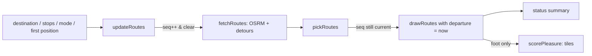

# Architecture overview

Barnacle Maps is a static, build-free single-page web app. `index.html` loads Leaflet from unpkg and then `src/app.js` as an ES module; `src/app.js` imports every pure helper from `src/geo.js`. There is no bundler, framework or server code: the only "backend" is a set of public OpenStreetMap services called straight from the browser (see [Running, dependencies and external services](../operations/running-and-external-services.md)).

## Module split

| Module | Responsibility | Can touch |
| --- | --- | --- |
| `src/geo.js` | Pure helpers: distance/duration/arrival formatting, Nominatim URL + result parsing, OSRM URL + route parsing, local geometry (detour waypoints, path sampling, overlap), route selection, stop list operations, pleasure pixel maths. | Nothing outside its arguments: no DOM, no `fetch`. |
| `src/app.js` | Controller: creates the Leaflet map, wires DOM events, holds all mutable state, performs network requests, draws routes/markers and writes status text. | DOM, `window.L`, `navigator.geolocation`, `fetch`, canvas. |

The file header of `geo.js` states the rule explicitly: it has no DOM access and no fetch so it can be unit tested in Node. Stop helpers also never mutate the list they are given; they return new arrays. That split is what lets most tests import `geo.js` directly, while `app.js` is tested through a fake-DOM harness (see [Test suite](../testing/test-suite.md)).

## Page layout

`index.html` has a full-screen `#map` and a floating `#panel` containing:

- `#search-form` / `#search-input` — place search ([Place search](../features/search.md));
- `#mode` radio group — Walk (`foot`, default) or Car (`car`);
- `#results` — search results, each with a route button and an "Add as stop" button;
- `#stops-box` with `#stops` and `#clear-stops` — hidden while there are no stops ([Stops](../features/stops.md));
- `#routes` — one button per route ([Routing](../features/routing.md));
- `#status` (`role="status"`) — the single line of user-facing feedback.

`styles.css` only positions the panel and styles selected routes, the pleasure line and stop markers.

## Application state

All state lives in module-level `let` variables in `app.js`:

- `position` — latest geolocation fix (`watchPosition`, high accuracy). The first fix centres the map once (`centered`).
- `currentPlace` — the chosen destination; `destMarker` its marker.
- `mode` — `"foot"` or `"car"`, changed by the radio buttons (only values in `TRAVEL_MODES` are accepted).
- `stops` / `stopMarkers` — ordered intermediate stops.
- `routeLayers` — one `{ route, line, button, pleasure }` entry per drawn route; `selectedRoute` is the highlighted index.
- `routeSeq`, `searchSeq` — monotonically increasing request counters.
- `pleasureAbort` — `AbortController` of the in-flight tile download.
- `pendingRoute` — a destination was chosen before the position was known.

## The route pipeline

`updateRoutes()` is the single place that (re)computes routes. It is called when a destination is picked (`showRoute`), when stops change (`setStops`), when the mode changes while a destination exists, and when the first position arrives for a pending route.

1. Snapshot `mode`, `currentPlace` and a copy of `stops`, then increment `routeSeq`.
2. Abort any pleasure scoring and clear all drawn routes immediately, so old routes and arrival times disappear as soon as a recomputation starts.
3. Without a destination, show a hint (or nothing); without a position, set `pendingRoute`, centre on the destination and wait.
4. `fetchRoutes()` asks OSRM for alternatives and, for walking without stops, detours; `pickRoutes()` keeps up to 3 distinct routes.
5. If `routeSeq` changed meanwhile the result is dropped. Otherwise the departure time is taken (`new Date()`), routes are drawn, the status summary is written and, for walking, pleasure scoring starts in the background.

### Stale-result protection

Every asynchronous flow compares a captured sequence number with the current one before touching the UI: `runSearch` uses `searchSeq`; `updateRoutes`, `fetchRoutes` and `scorePleasure` use `routeSeq`. Picking a place or adding a stop also bumps `searchSeq` so late suggestions cannot reappear. Pleasure tile downloads are additionally cancelled with an `AbortController`. Later position updates only move the user marker; they do not recompute routes unless a route was pending.

## Map interaction

Route polylines use `bubblingMouseEvents: false` and stop propagation, so clicking a route selects it rather than opening the map-click "Add stop here" popup. After drawing, the map fits the bounds of all routes, stop markers, the destination and the user marker.

## Related pages

- [Routing and travel modes](../features/routing.md)
- [Arrival time](../features/arrival-time.md)
- [Pleasure indicator](../features/pleasure.md)
- [Stops](../features/stops.md)
- [Place search](../features/search.md)
