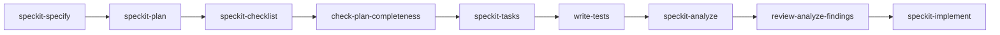

# Spec-driven development workflow

Recent features (stops, arrival time) were built by an automated "software factory" using [Spec Kit](https://github.com/github/spec-kit). Commit history shows the pattern: `Spec for …`, then `gate(...)` commits, then the feature commit, then (older features) `Add factory tests`. Knowing the workflow helps you find *why* code is the way it is: each feature folder under `specs/` records requirements (FR-xxx), success criteria (SC-xxx), research decisions (R-n) and user stories that the tests cite by ID.

## Where things live

| Path | Content |
| --- | --- |
| `.specify/` | Spec Kit installation: templates (`spec`, `plan`, `tasks`, `checklist`, `constitution`), helper scripts, the `speckit` workflow and the `git` extension. |
| `.specify/memory/constitution.md` | Project constitution. Currently the **unfilled template** (placeholders only), so no project-specific principles are enforced by it. |
| `.specify/feature.json` | Points at the active feature folder; gitignored, so usually absent in a fresh checkout. |
| `specs/<feature>/` | Per-feature artefacts: `spec.md`, `plan.md`, `research.md`, `data-model.md`, `contracts/`, `quickstart.md`, `checklists/`, `tasks.md`, `analyze-report.md`, `analyze-dismissed.md`, `gate-asked.md`. |
| `.claude/skills/speckit-*` | Claude Code skills for each Spec Kit command (specify, clarify, plan, checklist, tasks, analyze, implement, converge, constitution, git helpers). |
| `.claude/skills/{check-plan-completeness,write-tests,review-analyze-findings}` | Factory-specific gate skills inserted between Spec Kit steps. |
| `.claude/skills/visual-briefing` | Formatting guidance for factory reports (STE100 text, tables, Mermaid). |
| `tests/ai/` | AI test scenarios executed by an agent against the running app (see [Test suite](../testing/test-suite.md)). |

## Pipeline

The core Spec Kit workflow (`.specify/workflows/speckit/workflow.yml`) is specify → review gate → plan → review gate → tasks → implement. The factory adds its own gates:

- **check-plan-completeness** turns unticked checklist items (`CHK…`) into questions for a human, applies the answers to the spec/plan and records the questions in `gate-asked.md`.
- **write-tests** writes, before any code, deterministic tests that fail until the feature is built plus AI scenarios under `tests/ai/`, records them as tasks in `tasks.md`, and commits as `gate(write-tests): tests`. It never waits for human approval.
- **review-analyze-findings** fixes or dismisses each `speckit-analyze` finding, asking a human only when needed; dismissals are recorded in `analyze-dismissed.md`.

The git extension (`.specify/extensions.yml`) hooks Spec Kit commands, e.g. creating a feature branch before `specify` and offering commits before later steps. Factory branches are named `factory/<ticket>-<slug>`.

## Working on a feature

1. Read `specs/<feature>/spec.md` for user stories and FR/SC IDs, then `plan.md` and `contracts/` for the intended code shape.
2. Tests reference these IDs in their names (for example `test/arrival-panel.test.js`), so a failing test points back to a requirement.
3. The example feature folder is `specs/pilot-97524-show-the-arrival-time-for-each-route/`, documented in [Arrival time](../features/arrival-time.md).

## Related pages

- [Test suite](../testing/test-suite.md)
- [Arrival time](../features/arrival-time.md)
